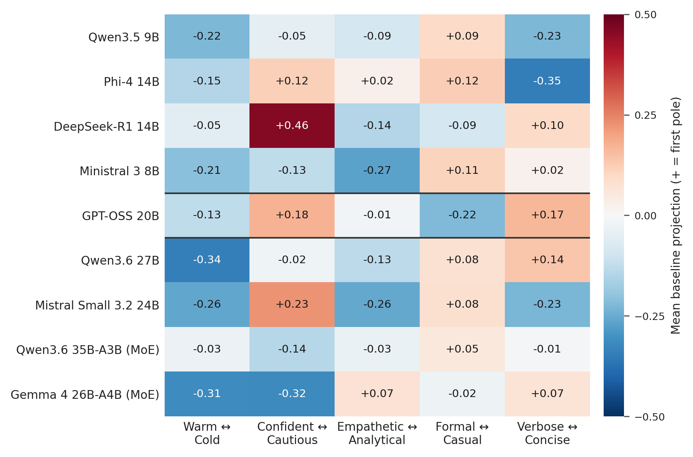
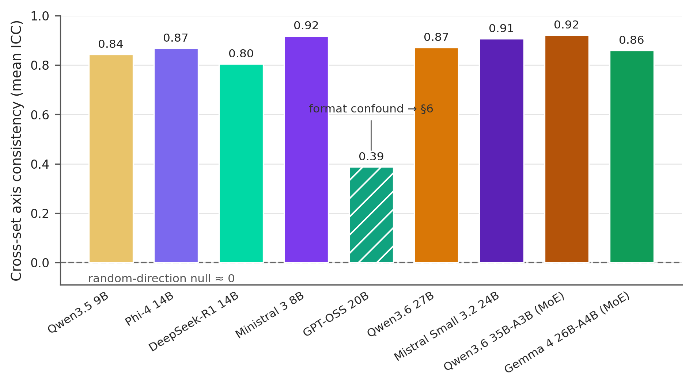
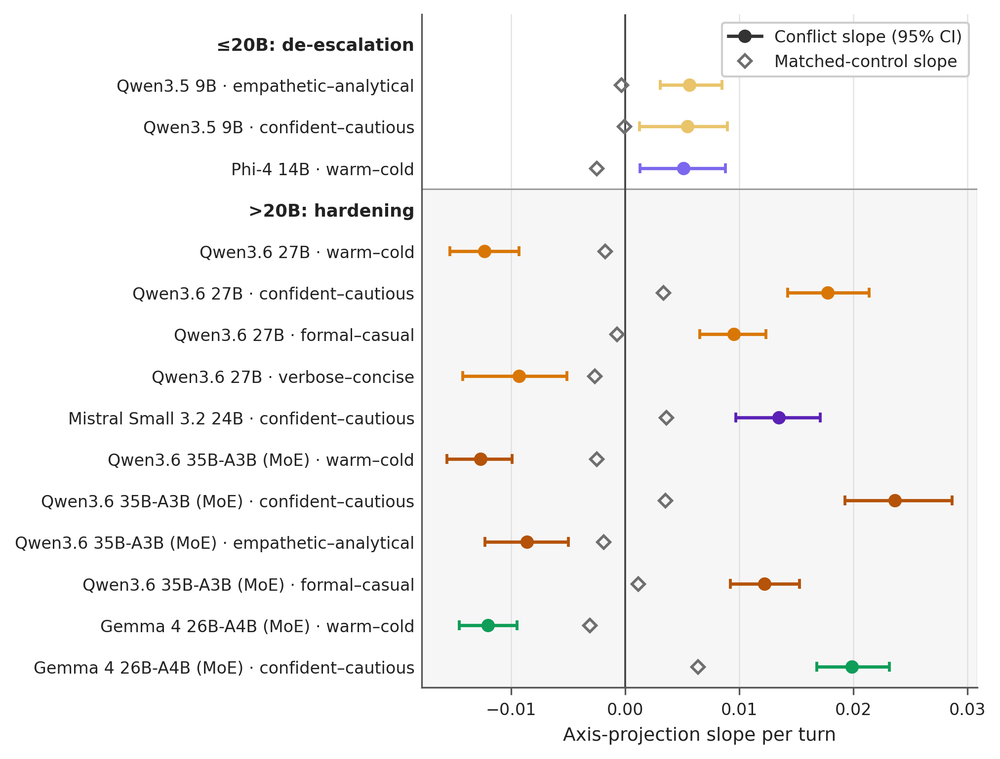
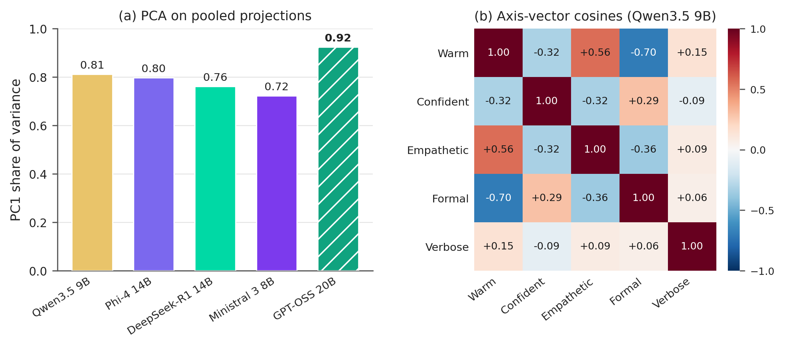

# Mood Axis: Measuring and Steering LLM Personality via Hidden States

Large language models exhibit consistent behavioral tendencies — characteristic patterns in tone, verbosity, confidence, and emotional expression — that persist across diverse prompts even without explicit instructions. **Mood Axis** is a two-part framework for measuring and controlling these tendencies through hidden state representations.

**Part 1 (Measurement).** We calibrate direction vectors from contrastive instruction pairs and project model responses onto 5 bipolar personality axes (warm/cold, confident/cautious, empathetic/analytical, formal/casual, verbose/concise). Evaluation across current-generation open-source models with three validation levels — held-out accuracy, cross-set axis consistency (0.80–0.92 across 3 independent calibration sets for eight of the nine cohort models), and a full layer-depth sweep — demonstrates that each model has a distinct, stable behavioral fingerprint. Tracking those fingerprints through 50 adversarial multi-turn conversations against 30 matched neutral controls reveals *conflict drift* that splits by scale: smaller models de-escalate toward the empathetic pole, while every >20B model in the cohort hardens — colder, more confident, more formal.

**Part 2 (Steering).** The same calibrated vectors, added to hidden states during generation, shift personality in the predicted direction — try it live in the [Steering Playground](https://yunoshev.github.io/mood-axis/). The quantitative steering results are currently being recomputed under a strict zero-truncation generation protocol and will land in the next data update.

> **[Interactive Explorer](https://yunoshev.github.io/mood-axis/)** — browse personality fingerprints, compare models side-by-side, inspect drift trajectories turn by turn, and try the **Steering Playground**: drag a slider to shift a model's personality and watch the actual text change.



---

**Table of Contents**

- [Quick Start](#quick-start)
- [Methodology](#methodology)
- [Behavioral Fingerprints](#behavioral-fingerprints)
- [Cross-Set Axis Consistency](#cross-set-axis-consistency)
- [Conflict Drift](#conflict-drift)
- [Axis Geometry and Dimensionality](#axis-geometry-and-dimensionality)
- [The GPT-OSS Anomaly: Format Dominance](#the-gpt-oss-anomaly-format-dominance)
- [Quantization Robustness](#quantization-robustness)
- [Base vs. Instruct Models](#base-vs-instruct-models)
- [Do Models Think with the Temperament They Answer With?](#do-models-think-with-the-temperament-they-answer-with)
- [Steering](#steering-part-2)
- [Key Findings](#key-findings)
- [Limitations](#limitations)
- [Models](#models)
- [Pipeline Reference](#pipeline-reference)
- [Data Files](#data-files)
- [Citation](#citation) · [License](#license)


## Quick Start

Everything runs standalone — plain `python3`, no job framework, no API keys (except the optional LLM-judge step).

```bash
git clone https://github.com/yunoshev/mood-axis.git
cd mood-axis
pip install -r requirements.txt

# Measure a model's personality (GPU or Apple Silicon; ~30-60 min per model)
python3 scripts/01_calibrate.py --model qwen3.5_9b --backend mlx   # calibrate 5 axis vectors
python3 scripts/02_baseline.py  --model qwen3.5_9b --backend mlx   # 30-question fingerprint

# Or via make:
make pipeline MODEL=qwen3.5_9b

# CPU-only: recompute the cross-model statistics from the shipped data
python3 scripts/06e_drift_stats.py        # drift slopes + significance
python3 scripts/06d_axis_geometry.py      # axis cosines, PCA, concept-cone rank
python3 scripts/07_figures.py             # all figures
```

- `--backend mlx` uses Apple MLX (2–5× faster on Apple Silicon; requires `pip install mlx mlx-lm`). Default backend is PyTorch (CUDA/CPU).
- Every GPU script supports `--check` for a preflight validation without loading the model.
- Model keys come from `config/models.py` (e.g. `qwen3.5_9b`, `phi4`, `deepseek_r1_14b`, `ministral3_8b`, `gpt_oss_20b`).
- Pre-computed outputs for the full cohort ship in this repo (see [Data Files](#data-files)), so every analysis step runs without any GPU time.


## Methodology

### The 5 axes

| Axis | Positive Pole | Negative Pole | What It Measures |
|------|--------------|---------------|-----------------|
| warm_cold | Warm | Cold | Emotional tone and friendliness |
| confident_cautious | Confident | Cautious | Certainty in responses |
| empathetic_analytical | Empathetic | Analytical | Emotional vs logical framing |
| formal_casual | Formal | Casual | Communication register |
| verbose_concise | Verbose | Concise | Response length tendency |

### Axis calibration

For each axis we present the model with neutral questions under contrasting system prompts — one instructing the positive pole ("Be warm and friendly"), the other the negative pole ("Be cold and distant") — and extract the residual stream at assistant-generated token positions only:

```
axis = normalize(trimmed_mean(H+) - trimmed_mean(H-))
```

where H+ and H− are hidden states from the two instruction conditions across 50 questions per pole (100 generations per axis), with 10% trimming for outlier robustness. Hidden states aggregate the final 4 layers with ramp weights and an exponential token-recency decay. Any response can then be projected onto the axis and normalized by the IQR of the calibration projections, giving interpretable values in [−1, +1].

**The 4-layer choice is validated, not assumed.** A post-hoc sweep over *every* layer of every model shows validation accuracy reaches a wide plateau by mid-network in instruction-tuned models (99% of peak accuracy between 21% and 71% of relative depth, depending on the model) and stays there — the final-4-layer aggregate sits on that plateau. An aggregation ablation (k ∈ {1, 2, 4, 8} last layers, uniform vs. ramp weights) moves mean validation accuracy by less than 0.01.

### Datasets (mutually disjoint)

| Dataset | Questions | Purpose |
|---------|-----------|---------|
| Calibration | 250 (50 per axis × 5) | Fit axis direction vectors |
| Evaluation | 75 (15 per axis × 5) | Held-out validation |
| Baseline | 30 | Neutral fingerprint measurement |
| Stability sets A/B/C | 450 (3 × 30 per axis × 5) | Cross-set consistency |

### Three validation levels

1. **Held-out accuracy** — projections of positive- vs negative-pole responses on 75 unseen questions separate correctly (>85% on instruct models; typically 100%).
2. **Cross-set axis consistency** — each axis is re-calibrated independently from 3 disjoint question sets; we report the mean pairwise Pearson correlation between the resulting direction vectors. The relevant null (random directions in a several-thousand-dimensional space) is ≈ 0, not 0.5.
3. **Layer sweep** — the signal is a wide mid-to-late-network plateau, not a fragile single-layer peak (Appendix A of the paper; `scripts/06b_layer_sweep.py`).

### Reasoning models: structural no-think protocol

Main-pipeline measurements probe the model's *answering* register, so reasoning-capable models (DeepSeek-R1, GPT-OSS, GLM-Z1, VibeThinker, Ministral Reasoning) must not emit a reasoning segment that would contaminate the pooled hidden states. The widely-used `enable_thinking=False` chat-template flag turns out to be a **silent no-op for every one of these models** — their published templates contain no such conditional. We disable reasoning *structurally* instead: the rendered prompt is extended with an already-closed empty reasoning block (`<think>\n\n</think>`, `[THINK][/THINK]`) or, for GPT-OSS, a forced jump into the Harmony final channel (`<|channel|>final<|message|>`). Verified on all 650 calibration responses per model: zero reasoning markers in generated text.

All experiments: temperature 0.7, top_p 0.9, seed 42, identical protocol across architectures.


<details>
<summary><b>Reproduce: calibration</b></summary>

**Prerequisites:** 16+ GB VRAM/unified memory for ≤14B models (Apple Silicon via `--backend mlx`, or CUDA/CPU via the default PyTorch backend). Weights auto-download from HuggingFace.

**Input:**
- `config/prompts.py` — calibration / evaluation / baseline question sets
- `config/settings.py` — axis definitions, generation parameters
- `config/models.py` — model registry (HF IDs, per-model quirks)

**Run:**
```bash
python3 scripts/01_calibrate.py --model qwen3.5_9b --backend mlx
# Useful flags:
#   --axes warm_cold,verbose_concise   subset of axes
#   --check                            preflight only, no GPU
#   --time-budget-min 25               clean checkpoint-exit after N minutes (rerun to resume)
```

Calibration is resumable by default: it checkpoints after every sample and skips already-computed axes. `--force` recomputes from scratch.

**Output:**
- `data/axes/qwen3.5_9b_axes.npz` — 5 axis vectors + per-axis normalization center/scale
- `data/axes/qwen3.5_9b_axes_meta.json` — val_accuracy, val_dprime per axis
- `data/axes/qwen3.5_9b_hidden_states.npz` — archived per-layer states (reused by the CPU analyses)

**Validation:** `val_accuracy ≥ 0.85` on all 5 axes for instruct models (typically 1.00).

**Pre-computed:** axis metadata for the full cohort ships in `v2/data/axes_meta/`.

</details>


## Behavioral Fingerprints

Each model's baseline temperament is the per-axis mean (± SD) of its projections on 30 neutral questions, answered with **no** persona instruction (reasoning models under the no-think protocol). The main cast plus GPT-OSS:

| Model | warm_cold | confident_cautious | empathetic_analytical | formal_casual | verbose_concise |
|---|---|---|---|---|---|
| Qwen3.5 9B | −0.22 (0.04) | −0.05 (0.07) | −0.09 (0.04) | +0.09 (0.07) | −0.23 (0.17) |
| Phi-4 | −0.15 (0.11) | +0.12 (0.12) | +0.02 (0.09) | +0.12 (0.15) | −0.35 (0.23) |
| DeepSeek-R1 14B | −0.05 (0.22) | **+0.46** (0.16) | −0.14 (0.09) | −0.09 (0.12) | +0.10 (0.13) |
| Ministral 3 8B | −0.21 (0.04) | −0.13 (0.06) | −0.27 (0.03) | +0.11 (0.03) | +0.02 (0.07) |
| GPT-OSS 20B | −0.13 (0.15) | +0.18 (**0.28**) | −0.01 (**0.23**) | −0.22 (0.16) | +0.17 (0.11) |

Four observations:

1. **No aligned assistant presents as warm by default.** Every model sits at or slightly below neutral on warmth (−0.03 to −0.34 across all 13 models with current-protocol baselines) — the assistant register is mildly cool everywhere; fingerprint differences live on the other axes.
2. **Confidence is where models differ most.** DeepSeek-R1 answers from a distinctly confident register (+0.46, the strongest baseline signal in the cohort) while Gemma 4 26B-A4B sits far on the cautious side (−0.32) — opposite poles of the same axis, consistent with organization-specific alignment styles. The signature also tracks training regime within a family: Ministral 3 8B *Reasoning* answers more confidently (+0.19) than plain Ministral 3 8B instruct (−0.13) on identical questions.
3. **GPT-OSS has the least stable fingerprint, not the most extreme one.** Its means are unremarkable, but its SDs on confident_cautious (0.28) and empathetic_analytical (0.23) are the widest in the table — the fingerprint-level trace of the instability diagnosed in [the format-confound section](#the-gpt-oss-anomaly-format-dominance).
4. **Suppression shows as flatness, not noise:** Qwen3.5 9B keeps |mean| < 0.10 on three of five axes with tight SDs — a stable, deliberately neutral profile (its cross-set consistency is main-cast-typical, 0.84).


<details>
<summary><b>Reproduce: fingerprints</b></summary>

**Input:** calibrated axes (`data/axes/<model>_axes.npz`, previous step) + `config/prompts.py` baseline questions.

**Run:**
```bash
python3 scripts/02_baseline.py --model qwen3.5_9b --backend mlx
```

**Output:** `data/baselines/qwen3.5_9b.json` — per-axis mean/std over 30 questions + full per-question projections and response texts.

**Validation:** projections lie in [−1, +1]; `_meta.n_questions == 30`.

**Pre-computed:** `v2/data/baselines/<model>.json` for the full cohort — these exact files back the fingerprint table above and the [Interactive Explorer](https://yunoshev.github.io/mood-axis/).

</details>


## Cross-Set Axis Consistency

Is a calibrated axis a property of the *model*, or an artifact of the particular calibration questions? We re-calibrate every axis three times from independent, disjoint question sets (A/B/C, 30 questions per axis each) and measure the mean pairwise correlation between the three resulting direction vectors.



**Eight of the nine cohort models land at 0.80–0.92** — far above the ≈ 0 null expected for random directions at this dimensionality. Axis vectors are a reproducible property of each model, not question noise.

The one exception is **GPT-OSS 20B (0.39)** — and its deficit is not sampling noise but a diagnosable property of its axis geometry: a dominant *format* response to persona prompts that its axes partly absorb. Removing a low-rank format subspace recovers most of the deficit (see [the format-confound section](#the-gpt-oss-anomaly-format-dominance)). Notably, MoE architecture does not explain it: Qwen3.6-35B-A3B and Gemma 4 26B-A4B — both sparse MoE models of comparable or larger scale — sit at 0.92 and 0.86.

Consistency is also decoupled from baseline magnitude: Qwen 3.5 9B pairs a deliberately neutral fingerprint with main-cast-typical consistency (0.84) — it stably reproduces suppressed responses rather than noise.


<details>
<summary><b>Reproduce: stability / consistency</b></summary>

**Input:** `config/stability_prompts.py` (3 × 150 questions) + `config/models.py`.

**Run:**
```bash
# GPU: calibrate the three independent sets (resumable; --set a|b|c to run one set)
python3 scripts/04_stability.py --model qwen3.5_9b --backend mlx calibrate

# CPU: cross-set consistency, rank-ICC, Procrustes congruence
python3 scripts/04_stability.py --model qwen3.5_9b analyze

# CPU: permutation null for the consistency statistic (all models)
python3 scripts/06h_consistency_null.py
```

**Output:**
- `data/stability/qwen3.5_9b.json` — per-axis cross-set correlations, ICC, Procrustes
- `data/analysis/consistency_null.json` — permutation-null z-scores per model

**Validation:** all cohort models except GPT-OSS: mean consistency ≥ 0.80; every model's consistency is many SDs above its permutation null.

**Pre-computed:** `v2/data/stability/<model>.json` + `v2/data/analysis/consistency_null.json`.

</details>


## Conflict Drift

Does personality *move* under pressure? We track axis projections through 50 adversarial multi-turn scenarios (10 categories — sarcasm, passive aggression, hostility escalation, … — 12 conflict turns + 4 recovery turns each) against **30 neutral control conversations of matched length**. An axis counts as showing *conflict-specific* drift only when its conflict-phase slope (a) has a 95% bootstrap CI excluding zero **and** (b) exceeds 2× the control slope — separating drift caused by hostility from drift that is simply an artifact of long conversations.

**Six of the nine models show at least one significant axis — and the pattern splits sharply by scale:**

| Model | Axis | Conflict slope [95% CI] | Control slope | Recovery |
|---|---|---|---|---|
| Qwen 3.5 9B | empathetic_analytical | +0.006 [+0.003, +0.009] | −0.000 | 62% |
| Qwen 3.5 9B | confident_cautious | +0.006 [+0.001, +0.009] | −0.000 | 48% |
| Phi-4 | warm_cold | +0.005 [+0.001, +0.009] | −0.003 | 31% |
| Qwen3.6 27B | warm_cold | −0.012 [−0.015, −0.009] | −0.002 | 30% |
| Qwen3.6 27B | confident_cautious | +0.018 [+0.014, +0.021] | +0.003 | 41% |
| Qwen3.6 27B | formal_casual | +0.010 [+0.007, +0.012] | −0.001 | 47% |
| Qwen3.6 27B | verbose_concise | −0.009 [−0.014, −0.005] | −0.003 | 36% |
| Mistral Small 3.2 24B | confident_cautious | +0.014 [+0.010, +0.017] | +0.004 | 40% |
| Qwen3.6-35B-A3B | warm_cold | −0.013 [−0.016, −0.010] | −0.003 | 38% |
| Qwen3.6-35B-A3B | confident_cautious | +0.024 [+0.019, +0.029] | +0.004 | 48% |
| Qwen3.6-35B-A3B | empathetic_analytical | −0.009 [−0.012, −0.005] | −0.002 | 52% |
| Qwen3.6-35B-A3B | formal_casual | +0.012 [+0.009, +0.015] | +0.001 | 48% |
| Gemma 4 26B-A4B | warm_cold | −0.012 [−0.015, −0.010] | −0.003 | 47% |
| Gemma 4 26B-A4B | confident_cautious | +0.020 [+0.017, +0.023] | +0.006 | 63% |



**Under sustained attack the >20B models harden: colder, more confident, more formal.** Every significant warm_cold slope in the >20B cohort is negative (−0.012 to −0.013), every significant confident_cautious slope is positive (+0.014 to +0.024), both significant formal_casual slopes are positive. Recovery is partial everywhere (30–63%): after the pressure lifts, the models drift back toward baseline but don't reach it within four recovery turns.

**The smaller models de-escalate instead.** Qwen 3.5 9B shifts toward the *empathetic* pole under conflict (+0.006, best recovery in the small cohort at 62%). Phi-4, Ministral 3 8B, and DeepSeek-R1 move the same way (+0.006 to +0.013), and the peak-conflict texts confirm it — Phi-4's projections climb from −0.09 to +0.31…+0.41 on turns opening with "I'm so glad to hear…" and "I apologize if my previous responses didn't meet your expectations…". These three don't pass the composite criterion for an instructive reason: their *control* conversations drift the opposite way (toward analytical), so the magnitude-only 2× clause fails even though the conflict-vs-control difference is highly significant by permutation test (p ≤ 0.0008, FDR-surviving). What hostility elicits from smaller models is conciliatory de-escalation, not analytical detachment.

**Neutral controls drift too — matching for it matters.** With 30 controls, control slopes are often reliably nonzero: Ministral's confident_cautious rises at +0.018/turn in *neutral* conversations (vs +0.019 under conflict — conversation length, not hostility, drives it). Conversation length alone is an active confound; that's exactly what the control condition and the 2× clause absorb.

**GPT-OSS 20B: large movement, none of it conflict-specific.** Its conflict slopes reach ±0.03 — but its *control* slopes are even larger (confident_cautious: conflict −0.026 vs control **+0.065**). Neutral small talk moves GPT-OSS's projections as much as sustained attack, so nothing survives the criterion: its instability is a standing representational property, not a reaction to hostility.

**Multiplicity check.** Applying Benjamini–Hochberg FDR (q=0.05) to permutation p-values across all 44 model × axis tests: 12 of the 14 composite-significant axes survive (the two that don't owe their composite pass to near-zero control slopes and are treated as tentative); 26 of 44 tests show FDR-significant conflict-vs-control *differences*. The composite verdicts are insensitive to the arbitrary 2× ratio choice (13 vs 17 axes at 3× / 1.5×).


<details>
<summary><b>Reproduce: conflict drift</b></summary>

**Input:** calibrated axes + `config/conflict_scenarios.py` (50 scenarios) + `config/drift_prompts.py` (30 neutral controls).

**Run:**
```bash
# GPU: run the 50 conflict scenarios + 30 controls (checkpointed per scenario, resumable)
python3 scripts/05_drift.py --model qwen3.5_9b --backend mlx
#   --scenarios 5     quick smoke run
#   --reproject       recompute projections from saved hidden states (no generation)

# CPU: slopes, bootstrap CIs, composite significance, recovery
python3 scripts/06e_drift_stats.py

# CPU: permutation tests + BH-FDR across all 44 model x axis tests
python3 scripts/06n_drift_multiplicity.py

# CPU (robustness): re-run the full significance machinery on format-partialled axes
python3 scripts/06m_partialled_drift.py
```

**Output:**
- `data/drift/<model>.json` — per-turn projections for every scenario and control
- `data/analysis/drift_stats.json` — slopes, CIs, composite verdicts, recovery ratios
- `data/analysis/drift_multiplicity.json` — permutation p-values, q_fdr per test
- `data/analysis/format_partialled_drift.json` — drift verdicts after format-subspace removal

**Validation:** `drift_stats.json` reports 9 models × 5 axes; every composite-significant axis in the table above has `significant_drift: true`.

**Pre-computed:** `v2/data/drift/<model>.json` (per-turn trajectories, LFS) + `v2/data/analysis/drift_stats.json` — the exact inputs behind the table, the figure, and the drift explorer on the site.

</details>


## Axis Geometry and Dimensionality

**The five axes are not fully orthogonal — and we quantify it rather than footnote it.** Across the five current-generation models analyzed (main cast + GPT-OSS), the maximum absolute cosine between any pair of axis vectors ranges 0.62–0.70, with warm_cold and formal_casual consistently the most anti-correlated pair (down to −0.70). PCA on the pooled contrastive projections yields a first principal component explaining 72–81% of variance for the main cast — the axes partly track a shared stylistic factor, so the effective dimensionality of "temperament" is meaningfully lower than 5. We keep reporting the axes separately because each has a distinct, interpretable meaning; a separate PCA over *baseline-response* projections gives PC1 = 26.8–34.5% with effective dimension 4.4–5.8 (a different space; the two PC1 ranges are not comparable).



**GPT-OSS 20B is the geometric outlier.** Its pooled projections collapse onto a single component (**92.5%** of variance — the strongest collapse in the cohort); its per-axis "concept cones" have depressed effective rank (0.51–0.76 vs 0.885–0.909 for DeepSeek-R1 under the identical no-think protocol); a secondary principal component captures up to 48% of residual variance on its weakest axis; and up to 27.7% of contrastive pairs on empathetic_analytical are *anti-directed* relative to the axis they define. Every axis still beats a label-permutation null decisively (z = 8.3–14.7) — the axes are real directions, just not cleanly single-direction ones. The anomaly persists across the model's two generation regimes (its axis directions shift between regimes, cosine 0.44–0.80 — far more than DeepSeek's 0.66–0.91 — but the degenerate-geometry signatures survive in both), which rules out reasoning-segment contamination. MoE routing and 4-bit precision are also ruled out (see the sections around this one). What actually explains it is next.


<details>
<summary><b>Reproduce: axis geometry</b></summary>

**Input:** archived calibration hidden states (`data/axes/<model>_hidden_states.npz`, written by `01_calibrate.py`).

**Run:**
```bash
python3 scripts/06d_axis_geometry.py            # all default models
#   --models qwen3.5_9b,gpt_oss_20b             subset
#   --n-permutations 200 --seed 42              permutation null settings
```

**Output:** `data/analysis/axis_geometry.json` — pairwise axis cosines, pooled-projection PCA, concept-cone effective rank, pairwise coherence, anti-directed pair fractions, permutation z-scores.

**Pre-computed:** `v2/data/analysis/axis_geometry.json`.

</details>


## The GPT-OSS Anomaly: Format Dominance

A dedicated confound analysis identifies what GPT-OSS's competing off-axis direction actually is: **response format**. On persona calibration prompts, GPT-OSS changes *how much and how* it writes far more than it changes style-in-content:

- "empathetic" responses average **529 tokens vs 865** for "analytical" (DeepSeek: 101 vs 142);
- "warm" responses **1075 tokens vs 400** for "cold";
- the analytical pole is **100% markdown-structured documents vs 54%** for the empathetic pole;
- safety refusals play no role (2 refusals in 650 calibration responses — fewer than stable models like Gemma 4, at 19).

As a result, three of its five axis directions substantially share the length/verbosity direction — cosine with its own verbose_concise axis: 0.57 (warm_cold), −0.63 (confident_cautious), −0.65 (empathetic_analytical) — versus |cos| ≤ 0.26 for every content axis of DeepSeek and Gemma 4.

**Projecting out a low-rank format subspace** (the verbose_concise contrast direction + top-3 PCs of its variation) **restores held-out pair separation on empathetic_analytical from 0.73 to 1.00** and raises cross-set axis agreement 0.70→0.81 (warm_cold), 0.37→0.51 (confident_cautious), 0.62→0.71 (empathetic_analytical) — while the identical operation leaves DeepSeek's and Gemma 4's axes unchanged (±0.03). A genuine temperament signal exists in GPT-OSS; it is masked by a dominant, *noisy* format response to persona instructions.

**The check generalizes — and is nearly free.** Run cohort-wide, it separates "axis direction contains format" (common, mostly benign: 6 of 46 models exceed the |cos| ≥ 0.4 flag, but all except GPT-OSS still pass held-out validation at 1.00) from "axis is *destabilized* by format" (GPT-OSS only: there the flagged direction, a strong projection–length correlation r = −0.74, degraded held-out separation, and depressed consistency all co-occur, and only there does removing the format subspace repair them). It needs no extra generation — only artifacts every axis fit already produces. We recommend it as a standard sanity check for contrastive persona-direction methods.

**Robustness of the drift results:** re-running the full drift significance machinery on format-partialled axes changes no verdict — every significant axis stays significant, six axes *gain* significance (format variance was masking signal, not creating it), and GPT-OSS's large-but-nonspecific movements collapse toward zero, confirming most of what moved for that model was format.


<details>
<summary><b>Reproduce: format-confound check</b></summary>

**Input:** archived calibration hidden states + response texts (written by `01_calibrate.py`).

**Run:**
```bash
python3 scripts/06k_format_confound.py          # full cohort
#   --models gpt_oss_20b,deepseek_r1_14b        subset
python3 scripts/06m_partialled_drift.py         # drift robustness on partialled axes
```

**Output:**
- `data/analysis/format_confound.json` — per-model, per-axis: cos(axis, verbose_concise), projection–length correlations, raw→partialled held-out accuracy and cross-set agreement
- `data/analysis/format_partialled_drift.json` — raw vs partialled drift verdicts

**Validation:** GPT-OSS empathetic_analytical: `val_pair_acc` 0.73 → 1.00 after partialling; DeepSeek/Gemma 4 axes change by ≤ 0.03.

**Pre-computed:** `v2/data/analysis/format_confound.json`, `v2/data/analysis/format_partialled_drift.json`.

</details>


## Quantization Robustness

Models up to ~14B are measured in bf16; models above 20B in 4-bit quantization (the precision most deployments actually run). To verify this mixed-precision design doesn't confound comparisons, every main-cast model was calibrated **twice** — once in bf16 and once in 4-bit — and the pairing repeated for all four >20B models.

Across all eight paired models (40 axis pairs): **axis directions are essentially precision-invariant** — mean cosine between bf16 and 4-bit axis vectors is 0.95 (per-model means 0.92–0.96, pooled minimum 0.85), and held-out validation accuracy is unchanged (0.996 in both precisions on average). The neutral point of an axis can shift slightly between precisions (mean 0.10 calibration-scale units, occasionally up to ~0.6), which is why every reported projection is normalized by the center and scale of its *own* precision's calibration.

<details>
<summary><b>Reproduce: quantization robustness</b></summary>

**Input:** paired axis files — `data/axes/<model>_axes.npz` and `data/axes/<model>_4bit_axes.npz` (calibrate the 4-bit twin with `python3 scripts/01_calibrate.py --model qwen3.5_9b_4bit --backend mlx`).

**Run:**
```bash
python3 scripts/06j_quant_robustness.py
```

**Output:** `data/analysis/quant_robustness.json` — per-axis cosines, center/scale shifts, validation accuracy in both precisions.

**Pre-computed:** `v2/data/analysis/quant_robustness.json`; 4-bit twin calibration metadata in `v2/data/axes_meta/`.

</details>


## Base vs. Instruct Models

Do aligned models lose their personality, or learn to hide it? The evidence points to a third option: **instruction tuning reorganizes personality representations without erasing them.**

**Representational separability survives alignment.** For 75 held-out items (5 axes × 15 questions), we project hidden states from positive-pole vs negative-pole instructions onto each model's own calibrated axis. Separability is near-ceiling in *both* versions of all three families tested — 93–97% base vs 100% instruct (Llama-8B, Qwen-7B, Mistral-7B), with no McNemar test reaching significance. Simple suppression (which predicts collapse toward chance in instruct models) is ruled out.

**The axis direction pre-dates alignment.** Cross-calibration is the sharper test: an axis fit purely on a *base* model's hidden states still separates the corresponding *instruct* model's held-out states almost perfectly (**97.3%**), while the reverse transfer is noticeably weaker (80.4%, below even base models' own 90.3% within-model accuracy). Mean cosine between corresponding base and instruct axis vectors is 0.44. The asymmetry is the informative part: instruction tuning *sharpens and cleans* a direction that already exists in the base model rather than creating it — an instruct-only axis is a noisier, more idiosyncratic version of a direction the base model already encodes.

**Where a real alignment effect does show up:**
- Base models are least reliable specifically on *stylistic-register* axes: every base model's single weakest validation axis is warm_cold or formal_casual (Gemma-9B formal_casual 61.3%, Llama-8B warm_cold 76.0%, Mistral-7B formal_casual 76.9%, Qwen-7B warm_cold 79.1%) — while the corresponding instruct model is at or near 100% on that same axis.
- An independent linear probe (trained directly on hidden states, no per-model axis) decodes *which personality instruction produced a given state* markedly less reliably from instruct representations than from base ones — reduced representational legibility, not erasure.
- Refusal-direction ablation on Qwen 2.5 partially restores base-like axis geometry (33–50% recovery) — the reorganization is tied to a specific RLHF component and is partly reversible.

**What this does not show:** none of the above is *behavioral* evidence that instruct models comply with personality-directed prompts less often — that requires judged behavioral labels we have not collected (see Limitations).

<details>
<summary><b>Reproduce: base vs instruct</b></summary>

**Input:** hidden states + axes for the base/instruct pairs (`llama_8b`/`llama_8b_base` etc.), produced by `01_calibrate.py`.

**Run:**
```bash
python3 scripts/06f_probe_stats.py          # item-level separability + McNemar (75 items)
python3 scripts/06g_cross_calibration.py    # base<->instruct axis transfer
```

**Output:** `data/analysis/probe_stats_75q.json`, `data/analysis/cross_calibration.json`.

**Pre-computed:** `v2/data/analysis/probe_stats_75q.json`, `v2/data/analysis/cross_calibration.json`.

</details>


## Do Models Think with the Temperament They Answer With?

Reasoning models expose a second register: the reasoning segment generated before the visible answer. Projecting think and answer segments separately (30 questions, paired by question, bootstrap 95% CIs), we pre-registered that thinking would be *colder and more analytical* than answering — "performative warmth". **The hypothesis fails in its universal form**, and the cohort splits three ways:

| Model | think − answer: warm_cold | confident_cautious | empathetic_analytical |
|---|---|---|---|
| DeepSeek-R1 14B | **+0.28** [+0.24, +0.33] | **−0.25** [−0.31, −0.18] | **+0.24** [+0.21, +0.26] |
| GPT-OSS 20B | **−0.41** [−0.54, −0.29] | **+0.39** [+0.29, +0.49] | **+0.24** [+0.14, +0.33] |
| GLM-Z1 9B | +0.08 [+0.06, +0.10] | **−0.15** [−0.18, −0.12] | +0.08 [+0.07, +0.10] |
| VibeThinker 3B | −0.10 [−0.13, −0.07] | **+0.65** [+0.61, +0.69] | **−0.25** [−0.27, −0.23] |
| Ministral 3 8B Reasoning | +0.01 [−0.00, +0.03] | −0.09 [−0.13, −0.06] | +0.02 [+0.01, +0.04] |

DeepSeek thinks *warmer* and more empathetically than it answers — the mirror image of the hypothesis. GPT-OSS thinks colder yet *more* empathetically. VibeThinker is the closest match but couples it with a huge confidence surge while thinking (+0.65, the largest effect in the study). The one near-regularity runs through confidence: **three of five models deliberate more cautiously than they deliver** — hedged reasoning behind a confident answer. Thinking temperament, like conflict drift, is a per-model property, not a law of the reasoning regime.

<details>
<summary><b>Reproduce: think vs answer</b></summary>

**Run:**
```bash
python3 scripts/07_thinking.py --model deepseek_r1_14b --backend mlx   # GPU: paired generations
python3 scripts/06l_think_stats.py                                     # CPU: paired contrasts + CIs
```

**Output:** `data/analysis/think_stats.json`. **Pre-computed:** `v2/data/analysis/think_stats.json`.

</details>


## Steering (Part 2)

Part 1 established that personality is linearly encoded in hidden states. Part 2 asks whether those representations are *causal*: add the calibrated axis vector, scaled by a coefficient α, to the hidden states at a mid-network layer during generation —

```
h'_l = h_l + α · (v_axis × h_norm)
```

— and the generated text shifts along the targeted axis. The `h_norm` factor (median hidden-state L2 norm at the target layer) makes α comparable across architectures whose hidden-state norms differ by up to 5000×. Injection layers are selected per model by an empirical sweep (optimal layers cluster in the 25–65% depth range, consistent with middle layers encoding stylistic properties).

The effect is deliberately subtle: steered text shifts in tone and style while staying factually and topically intact — warm-steered text picks up exclamation marks, second-person address and positive framing; cold-steered text stays factually identical but tonally neutral. That subtlety is the point: it confirms the axes capture genuine internal tendencies rather than surface templates.

**Try it live:** the [Steering Playground](https://yunoshev.github.io/mood-axis/) shows real steered generations — drag the α slider and watch the same answer change temperament.

> **Data status:** the quantitative steering results (dose-response slopes, per-model steerability, external judge validation) are being **recomputed under a strict zero-truncation protocol** — earlier runs capped generation at 384 tokens, which truncated long steered responses and could bias per-axis effects. Updated numbers, figures, and playground texts will land in the next data update; the qualitative picture above is unaffected.

<details>
<summary><b>Reproduce: steering</b></summary>

**Input:** calibrated axes (`data/axes/<model>_axes.npz`) + layer-sweep result (`data/steering_sweep/<model>_sweep.json`).

**Run:**
```bash
# GPU: layer sweep (picks the injection layer)
python3 scripts/steering_layer_sweep.py --model qwen3.5_9b --backend mlx

# GPU: dose-response over alphas x questions (checkpointed per question, resumable)
python3 scripts/steering_basic.py --model qwen3.5_9b --backend mlx
#   --axes warm_cold          one axis
#   --analyze                 recompute stats from saved generations (CPU)

# Optional: external LLM judge (needs ANTHROPIC_API_KEY)
python3 scripts/steering_judge_prep.py && python3 scripts/steering_judge.py
```

**Output:** `data/steering/<model>_basic.json` — per-alpha generations, projections, slopes, leakage.

**Pre-computed:** `v2/data/steering/<model>_basic.json` (LFS) — these back the current playground; they predate the zero-truncation rerun noted above.

</details>


## Key Findings

1. **Distinct, stable behavioral fingerprints.** Each model has a characteristic per-axis profile, reproducible across independent calibration sets (cross-set consistency 0.80–0.92 for eight of nine cohort models). No aligned assistant presents as warm by default; confidence is where organizations differ most (DeepSeek +0.46 vs Gemma 4 −0.32).

2. **Conflict drift splits by scale.** Under sustained adversarial pressure, the >20B models harden — colder, more confident, more formal (six of nine models show conflict-specific drift; all four >20B models are among them) — while smaller models de-escalate toward the empathetic pole with apologetic, conciliatory text. Recovery is partial everywhere (30–63% within four post-conflict turns).

3. **Neutral conversations drift too.** With 30 matched controls, control-condition slopes are often reliably nonzero — conversation length alone moves personality projections. Any drift claim without a matched-length control is confounded.

4. **The GPT-OSS anomaly is format dominance, not MoE or quantization.** Its degenerate axis geometry and weakest-in-cohort consistency (0.39) trace to a dominant response-format reaction to persona prompts; projecting out a low-rank format subspace restores held-out separation from 0.73 to 1.00 on its worst axis. Two larger MoE models sit squarely in the stable cohort, and axis directions are precision-invariant across bf16/4-bit pairs (mean cos 0.95).

5. **Instruction tuning reorganizes personality representations without erasing them.** Own-axis separability is near-ceiling in both base and instruct models (93–97% vs 100%); a base-fit axis transfers to instruct states at 97.3% — the direction pre-dates alignment. The real alignment effect is subtler: reduced representational legibility and base-model unreliability on stylistic-register axes specifically.

6. **Reasoning models think with a different temperament than they answer — in model-specific directions.** DeepSeek thinks warmer, GPT-OSS colder, VibeThinker with a +0.65 confidence surge; the closest regularity is hedged deliberation behind confident delivery (3 of 5 models).

7. **The same vectors measure and steer.** Adding calibrated axis vectors to hidden states shifts generation along the targeted axis while preserving content — measurement directions are causally meaningful (quantitative steerability comparison being recomputed; see [Steering](#steering-part-2)).


## Limitations

1. **English-only dataset.** All questions are LLM-generated English; axis transfer to other languages is untested.
2. **No human validation of axis labels.** Axes are operationally defined through hidden-state separability, not human annotation.
3. **Style instructions carry lexical markers.** Some pole instructions suggest concrete phrasings ("I could be wrong, but…"), so axis vectors may partly encode those markers; confident_cautious is most exposed.
4. **verbose_concise partly measures length** (r ≈ 0.68 with raw response length) — part of what it captures is a length detector, not a purely stylistic disposition.
5. **Calibration poles are not length-matched.** Persona instructions are free to change response format along with style; for GPT-OSS this format response dominates the contrast. The format-confound check diagnoses and largely repairs this post-hoc; a length-matched calibration design is future work.
6. **Single chat template, single decoding regime, single run per model** (temperature 0.7, fixed seed). Bootstrap CIs cover question sampling, not run-to-run variance.
7. **Conflict scenarios are scripted, not interactive.** Every model faces literally the same pressure sequence (guaranteeing comparability), but a scripted accuser that ignores the model's apology is not a realistic dialogue partner; matched-length scripted controls bound but don't remove this concern.
8. **Gemma 3 12B excluded for steering degeneration.** Under hidden-state steering it collapses into repetition loops (a known sensitivity of the Gemma 3 12B/27B generation); available mitigations would all break cross-model protocol comparability, so it is excluded from all reported results rather than measured on degenerate text. None of the other eight current-generation models shows this failure mode under the identical protocol.
9. **No behavioral validation of instruction-following was collected.** The base-vs-instruct results are representational; whether they translate into different compliance rates with personality-directed prompts in generated text remains open.
10. **One instruction phrasing per pole.** Cross-set consistency shows robustness to changing the *questions*; robustness to paraphrasing the *instructions* is untested.


## Models

### Main cast (four organizations)

| Key | Model | Params | Organization | Notes |
|-----|-------|--------|--------------|-------|
| `qwen3.5_9b` | Qwen3.5 9B Instruct | ~9B | Alibaba | hybrid SSM architecture |
| `phi4` | Phi-4 | ~14B | Microsoft | — |
| `deepseek_r1_14b` | DeepSeek-R1-Distill-Qwen 14B | ~14B | DeepSeek | reasoning distillation |
| `ministral3_8b` | Ministral 3 8B Instruct | ~8B | Mistral | — |

### Analyzed alongside

| Key | Model | Params | Notes |
|-----|-------|--------|-------|
| `gpt_oss_20b` | GPT-OSS 20B | ~20B (MoE) | OpenAI; separate case study (format confound) |
| `qwen3.6_27b` | Qwen3.6 27B | ~27B | 4-bit |
| `mistral_small_3.2_24b` | Mistral Small 3.2 24B | ~24B | 4-bit |
| `qwen3.6_35b_a3b` | Qwen3.6-35B-A3B | ~35B (MoE) | 4-bit |
| `gemma4_26b_a4b` | Gemma 4 26B-A4B | ~26B (MoE) | 4-bit |

Together these nine models form the drift/consistency cohort. Each main-cast model also has a 4-bit twin (`*_4bit`) for the quantization-robustness check.

Gemma 3 12B was part of an earlier version of the cohort but is **excluded from all reported results**: under activation steering it degenerates into repetition loops, and no mitigation compatible with the fixed cross-model protocol resolved it (see Limitations).

### Legacy base/instruct pairs (Part 1 alignment analyses)

`llama_8b`/`llama_8b_base`, `qwen_7b`/`qwen_7b_base`, `mistral_7b`/`mistral_7b_base`, `gemma_9b`/`gemma_9b_base`, plus `qwen_7b_uncensored` (refusal-ablated) — used for the base-vs-instruct separability, cross-calibration, and refusal-ablation results.

The full registry (63 model keys, including Qwen scaling chains and the diverse appendix cohort) lives in `config/models.py`.


## Pipeline Reference

| Step | Script | GPU | Output |
|------|--------|:---:|--------|
| 1. Calibrate axes | `scripts/01_calibrate.py` | ✓ | `data/axes/<m>_axes.npz` + meta + hidden states |
| 2. Baseline fingerprint | `scripts/02_baseline.py` | ✓ | `data/baselines/<m>.json` |
| 3. Directional benchmark | `scripts/03_benchmark.py` | ✓ | `data/benchmarks/<m>.json` |
| 4. Stability sets A/B/C | `scripts/04_stability.py` | ✓ | `data/stability/<m>.json` |
| 5. Conflict drift | `scripts/05_drift.py` | ✓ | `data/drift/<m>.json` |
| 6. Cross-model stats | `scripts/06[d-o]_*.py` | — | `data/analysis/*.json` |
| 7. Figures | `scripts/07_figures.py` | — | `paper/figures/fig_*.png` |
| S. Layer sweep + steering | `scripts/steering_layer_sweep.py`, `scripts/steering_basic.py` | ✓ | `data/steering_sweep/`, `data/steering/` |

CPU analysis scripts (step 6):

| Script | Computes |
|--------|----------|
| `06b_layer_sweep.py` | per-layer validation accuracy / d′ sweep |
| `06d_axis_geometry.py` | axis cosines, pooled PCA, concept-cone rank, permutation nulls |
| `06e_drift_stats.py` | drift slopes, bootstrap CIs, composite significance, recovery |
| `06f_probe_stats.py` | base-vs-instruct item-level separability + McNemar |
| `06g_cross_calibration.py` | base↔instruct axis transfer |
| `06h_consistency_null.py` | permutation null for cross-set consistency |
| `06j_quant_robustness.py` | bf16 vs 4-bit axis invariance |
| `06k_format_confound.py` | format-confound check (cohort-wide) |
| `06l_think_stats.py` | think-vs-answer temperament contrasts |
| `06m_partialled_drift.py` | drift robustness on format-partialled axes |
| `06n_drift_multiplicity.py` | permutation tests + BH-FDR over all drift tests |
| `06o_layer_pooling_sensitivity.py` | per-layer / last-token pooling sensitivity |

Common make targets:

```bash
make pipeline MODEL=qwen3.5_9b   # steps 1-5 for one model
make analysis                    # step 6 (all models, CPU)
make figures                     # step 7
make readme                      # rebuild README.md from docs/sections/
make check MODEL=qwen3.5_9b      # preflight checks, no GPU
```


## Data Files

Two data trees with distinct roles:

**`v2/data/` — the pinned, curated dataset (single source of truth).** Every number in this README, every figure, and every value on the [Interactive Explorer](https://yunoshev.github.io/mood-axis/) is derived from these files — the site is rebuilt by `python3 v2/build_site_data.py`, which reads *only* `v2/data/` and writes `docs/site_data.json` + `docs/data/` (regenerated automatically by CI on every push that touches `v2/data/`). Nothing on the site or in the README is hand-entered.

| Directory | Contents |
|-----------|----------|
| `v2/data/models.json` | model registry for the site (names, orgs, colors, twins) |
| `v2/data/axes_meta/` | calibration quality per model (val accuracy, d′ per axis) |
| `v2/data/baselines/` | 30-question fingerprints + example responses |
| `v2/data/stability/` | cross-set consistency, rank-ICC, Procrustes |
| `v2/data/drift/` | per-turn drift trajectories, 50 scenarios + 30 controls per model (LFS) |
| `v2/data/steering/` | steering dose-response generations (LFS) |
| `v2/data/steering_sweep/` | layer-sweep summaries |
| `v2/data/analysis/` | all cross-model statistics (drift_stats, axis_geometry, format_confound, quant_robustness, …) |

**`data/` — the working directory the pipeline scripts write to.** Running any script from [Pipeline Reference](#pipeline-reference) reproduces outputs here; compare them against the pinned copies in `v2/data/`. (It also still contains some files from earlier iterations of this project; when in doubt, trust `v2/data/`.)

Large JSONs (drift trajectories, steering generations) are stored in **Git LFS** — `git lfs pull` after cloning if your clone skipped them.


## API Key Requirement

The external judge scripts (`scripts/steering_judge.py`, `scripts/judge_analyze.py`) call the Anthropic API:

```bash
export ANTHROPIC_API_KEY=your_key_here
python3 scripts/steering_judge.py
```

All other scripts are fully local and require no API keys.

## Citation

```bibtex
@misc{yunoshev2026moodaxis,
  title={Mood Axis: Measuring and Steering LLM Personality via Hidden States},
  author={Yunoshev, Andrey},
  year={2026},
  url={https://github.com/yunoshev/mood-axis}
}
```

## License

MIT
